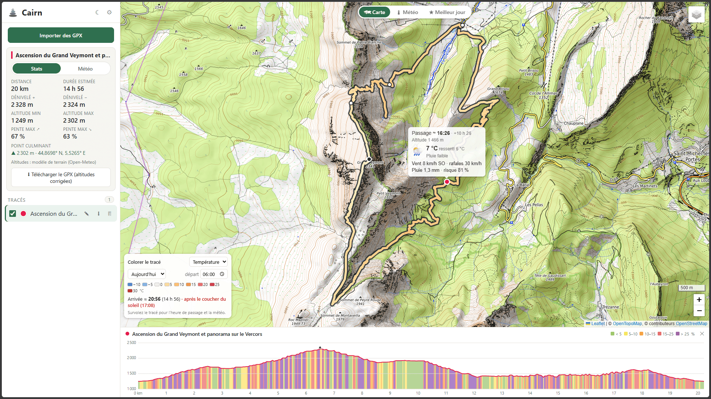
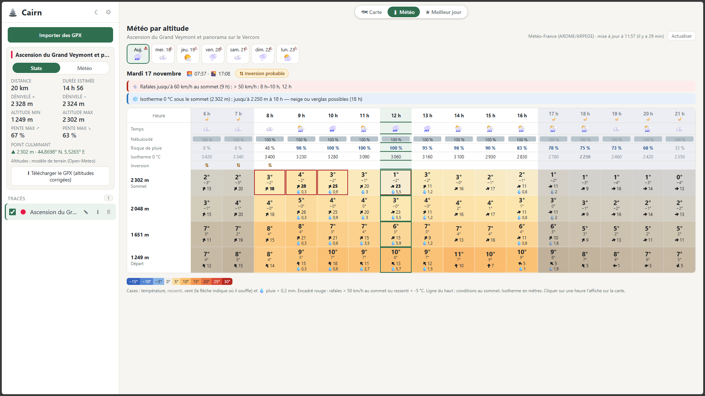
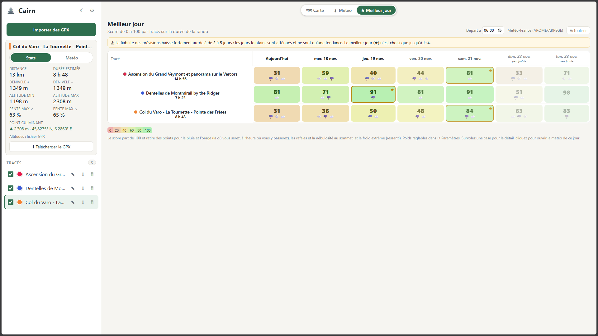
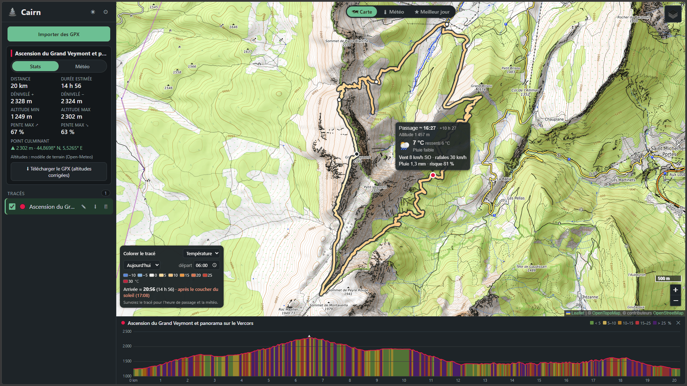
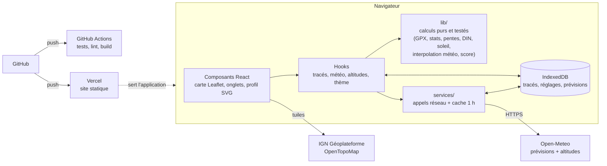
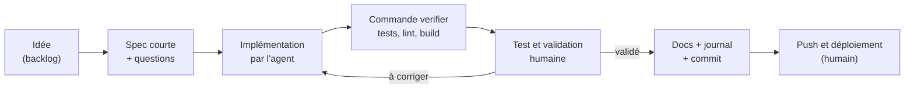

<div align="center">


# Cairn

**Planifier une rando en montagne avec la météo _à l'altitude où l'on marche_, pas celle de la vallée.**

[](https://github.com/Samoth45/Cairn/actions/workflows/ci.yml)
[][site]
[](https://github.com/Samoth45/Cairn/tags)
[](LICENSE)


### [▶ Essayer Cairn en ligne][site]

Sans compte, sans serveur : vos tracés restent dans votre navigateur.

</div>



## Le problème

Les prévisions habituelles donnent la météo d'une commune, donc d'une vallée. À 2 300 m, il
peut faire 8 °C de moins, le vent peut souffler en rafales et l'isotherme 0 °C passer sous le
sommet. Il arrive aussi, en inversion, qu'il fasse plus doux en haut qu'en bas. Préparer une
sortie, c'est savoir **quel temps il fera à chaque endroit du parcours, à l'heure où l'on y
passera**, et choisir le meilleur jour pour y aller.

Cairn part de vos fichiers GPX et répond à ces questions.

## Fonctionnalités

### 🗺 Carte

- Import de fichiers GPX (bouton ou glisser-déposer, plusieurs à la fois), dédoublonnés.
- Fonds de carte IGN Plan et OpenTopoMap.
- Statistiques : distance, dénivelés, altitudes, pentes maximales, point culminant, **durée
  estimée selon la norme DIN 33466** (vitesses réglables).
- Profil altimétrique coloré par classe de pente, synchronisé avec la carte au survol.
- **Tracé coloré selon la météo prévue au moment du passage** (température, rafales ou
  pluie), pour un jour et une heure de départ choisis ; heure d'arrivée et alerte si elle
  tombe après le coucher du soleil.
- Altitudes complétées automatiquement (modèle de terrain) quand le GPX n'en contient pas, et
  GPX retéléchargeable avec les altitudes corrigées.

### 🌡 Météo par altitude



- Tableau heure par heure (6 h – 21 h) sur 7 jours, pour jusqu'à 8 points du tracé choisis
  par altitude (sommet, départ, point bas, paliers intermédiaires).
- Température et ressenti, vent et rafales, pluie, nébulosité, isotherme 0 °C.
- Détection des **inversions de température** et alertes (rafales au sommet, orage, froid
  ressenti, isotherme sous le sommet).
- Lever et coucher du soleil, heure de départ au plus tard pour rentrer de jour.

### ★ Meilleur jour



- Score de 0 à 100 **par tracé et par jour**, calculé sur la durée réelle de la rando : pluie
  et orage là où vous serez à l'heure où vous y passerez, rafales et nuages au sommet, froid
  ressenti. Poids réglables.
- Fiabilité selon l'échéance : les jours lointains sont atténués et le meilleur jour (★)
  n'est choisi que jusqu'à J+4.
- Un clic sur une case ouvre la météo détaillée de ce jour.

### Et aussi

Mode sombre (qui suit le réglage de l'appareil), choix du modèle (Météo-France ou « meilleur
modèle » d'Open-Meteo), tout en français.

<p align="center">
  
</p>

## Choix techniques

| Choix | Pourquoi |
| --- | --- |
| **Aucun backend** : application statique, données dans IndexedDB (Dexie) | Hébergement gratuit, rien à administrer, les tracés de l'utilisateur ne quittent pas son navigateur. |
| **Uniquement des API gratuites et sans clé** : IGN Géoplateforme, OpenTopoMap, Open-Meteo | Aucun secret ni variable d'environnement : le dépôt se déploie tel quel. |
| **Une seule requête météo pour tous les points**, deux modèles fusionnés | Météo-France (AROME / ARPEGE) est le plus fin sur les Alpes, mais ne fournit ni probabilité de pluie ni isotherme et s'arrête vers J+4 : chaque valeur manquante est complétée par le « meilleur modèle » d'Open-Meteo, dans la même requête. |
| **Points météo choisis par altitude** puis interpolation en altitude et en temps | En montagne, c'est l'altitude qui fait varier la météo, plus que la distance. Le tracé est colorié tronçon par tronçon à partir de ces quelques points. |
| **Durée DIN 33466** recalée par tronçons | Norme des clubs alpins (temps horizontal et vertical combinés) ; appliquée par tronçons de 100 m pour obtenir l'heure de passage en chaque point. |
| **Soleil calculé localement** (formules astronomiques) | Fonctionne pour n'importe quel jour, sans réseau, avant même l'arrivée de la météo ; écart ≤ 2 min avec l'API. |
| **Graphiques en SVG écrits à la main** | Profil et légendes sur mesure (couleurs de pente, survol synchronisé avec la carte) sans dépendance lourde. |
| **Identifiant d'un tracé = empreinte de ses coordonnées** | Réimporter le même fichier ne crée pas de doublon. |
| **Docker pour le développement**, Vercel construit depuis les sources | Même environnement sur Windows, macOS et Linux sans rien installer d'autre ; le déploiement n'en dépend pas. |

## Architecture



## Quelques difficultés résolues

**Le tracé volait le survol, en production seulement.** Le marqueur de survol passait sous
la souris et faisait clignoter l'infobulle. Cause : Leaflet lit l'option `interactive` à
l'insertion d'une forme, alors que react-leaflet l'appliquait après ; en développement, le
StrictMode de React réinsère chaque couche et masquait le bug. Correction, puis règle
durable : tout comportement de carte se vérifie aussi sur le build de production.

**Des tuiles barrées d'un avertissement en local.** OpenTopoMap renvoie des images « Generic
referrer detected » aux pages servies depuis `localhost`. La couche n'envoie plus de referrer
**uniquement** en boucle locale ; en ligne, le site s'identifie normalement.

**Des heures de passage incohérentes.** La formule DIN (le plus grand des deux temps + la
moitié du plus petit) n'est pas additive : appliquée tronçon par tronçon, sa somme ne donne
pas la durée totale. Les heures de passage sont donc recalées sur la durée globale.

**Un modèle précis mais incomplet.** Météo-France ne fournit ni probabilité de pluie ni
isotherme, et s'arrête vers J+4. Plutôt que deux requêtes, les deux modèles sont demandés
ensemble et fusionnés valeur par valeur ; l'interface indique quand une heure vient du
modèle de secours.

**Un flash blanc au chargement en mode sombre.** Le thème est stocké en IndexedDB, lu trop
tard (après le premier affichage). Une copie dans `localStorage`, lue par un petit script
avant le rendu de React, applique le bon thème dès la première image.

## Méthode : développement 100 % agentique avec Claude Code

C'est l'objectif principal du projet : **je n'ai pas écrit une ligne de code.** Tout le code,
les tests, la configuration et la documentation technique ont été produits par
[Claude Code](https://claude.com/claude-code). Mon rôle : exprimer le besoin, trancher les
choix, tester et valider.

### La boucle de travail



- **Piloté par les specs.** Un cahier des charges en 6 étapes, puis, pour chaque nouvelle
  idée, une spec courte dans [`docs/specs/`](docs/specs/) (objectif, comportement attendu,
  contraintes, hors périmètre, comment tester). L'agent pose ses questions **avant** d'écrire
  du code ; mes réponses deviennent des décisions écrites dans la spec.
- **Humain dans la boucle.** L'agent s'arrête à la fin de chaque étape, explique comment
  tester et attend ma validation. Il ne commite que sur demande et **ne pousse jamais** :
  le push déclenche le déploiement, il reste un geste humain.
- **Une mémoire de projet versionnée.** Des fichiers `CLAUDE.md` hiérarchiques (racine,
  [`src/lib`](src/lib/CLAUDE.md), [`src/services`](src/services/CLAUDE.md),
  [`src/components`](src/components/CLAUDE.md)) consignent les règles, les décisions et
  leurs raisons, et les pièges rencontrés. Le journal
  [`docs/historique.md`](docs/historique.md) retrace chaque étape, et
  [`docs/backlog.md`](docs/backlog.md) liste les idées en attente.
- **Une définition de « terminé ».** La commande `/verifier` enchaîne tests, lint sans aucun
  avertissement, build de production (celui que Vercel exécutera) et contrôle du serveur de
  développement. La même routine tourne dans GitHub Actions à chaque push.
- **L'agent vérifie aussi ce qu'il voit.** Pour l'interface, il lance un navigateur sans
  écran (puppeteer) dans un conteneur jetable, sur le build de production, clique, mesure et
  relit ses propres captures d'écran avant de rendre la main.
- **Des garde-fous.** Tout passe par Docker (rien à installer sur le poste), aucune API à
  clé, aucun push par l'agent. Chaque incident devient une règle écrite pour ne pas se
  reproduire : un bug visible uniquement en production a imposé de tester la carte sur le
  build ; un piège propre à Windows est consigné dans un fichier d'instructions local au poste.

### En chiffres

Une semaine (du 11 au 17 novembre 2026), 6 étapes de cahier des charges puis une demi-douzaine d'évolutions,
environ 5 300 lignes de TypeScript, 115 tests unitaires, 4 fichiers `CLAUDE.md`.

<details>
<summary><strong>Développement local</strong></summary>

Seul prérequis : **Docker** (Docker Desktop sous Windows / macOS, Docker Engine + Compose
sous Linux). Ni Node ni npm sur la machine : tout passe par le conteneur.

```bash
git clone https://github.com/Samoth45/Cairn.git cairn && cd cairn
docker compose up dev                              # http://localhost:5173 (hot reload)
docker compose run --rm dev npm test               # tests (Vitest)
docker compose run --rm dev npm run lint           # ESLint, 0 avertissement toléré
docker compose run --rm dev npm run build          # typecheck + build de production
docker compose up --build prod                     # build servi par nginx : http://localhost:8080
```

Après l'ajout d'une dépendance : `docker compose up --build -V dev` (renouvelle le volume
`node_modules`). Le dossier [`samples/`](samples/) contient des GPX fictifs pour tester
l'import. Déploiement Vercel et intégration continue : [`docs/deploiement.md`](docs/deploiement.md).

</details>

## Crédits et licence

- Fonds de carte : © [IGN](https://geoservices.ign.fr/) (Géoplateforme) ;
  © [OpenTopoMap](https://opentopomap.org/) (CC-BY-SA), © contributeurs
  [OpenStreetMap](https://www.openstreetmap.org/copyright).
- Prévisions et altitudes : [Open-Meteo](https://open-meteo.com/) (CC BY 4.0), dont les
  modèles de Météo-France.
- Code sous licence [MIT](LICENSE) © 2026 Thomas Rabillon.

[site]: https://cairn-gpx.vercel.app/
